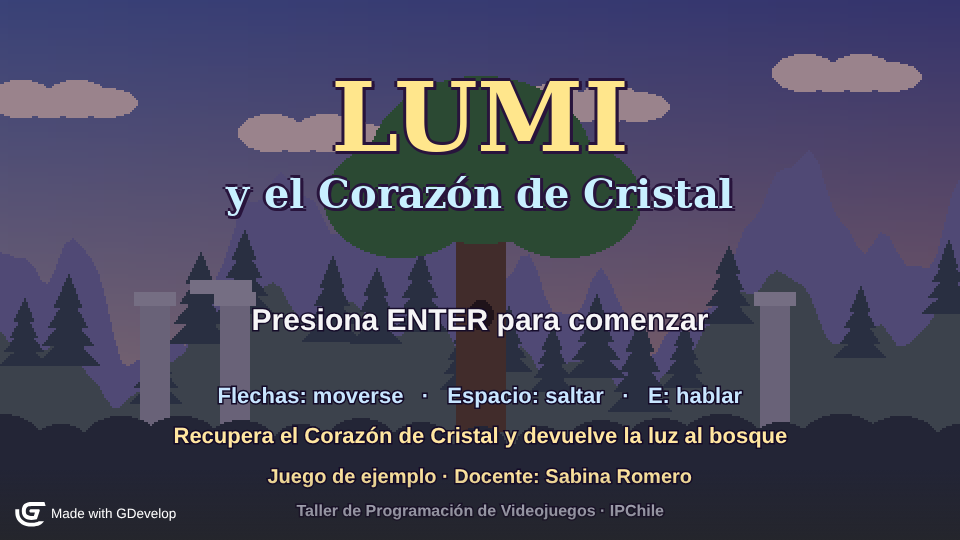
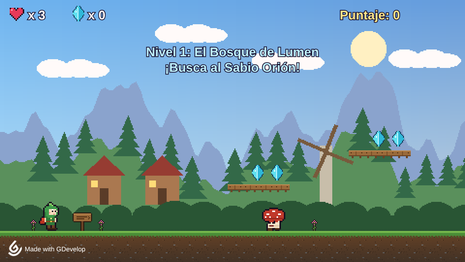
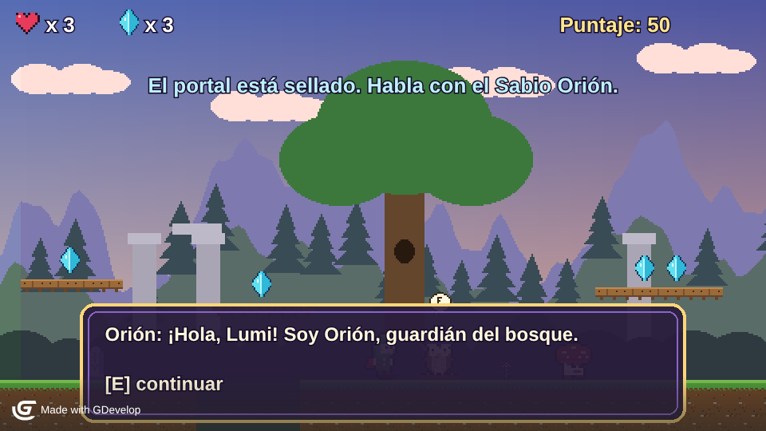
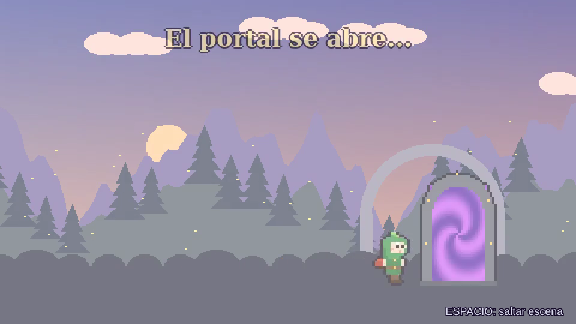
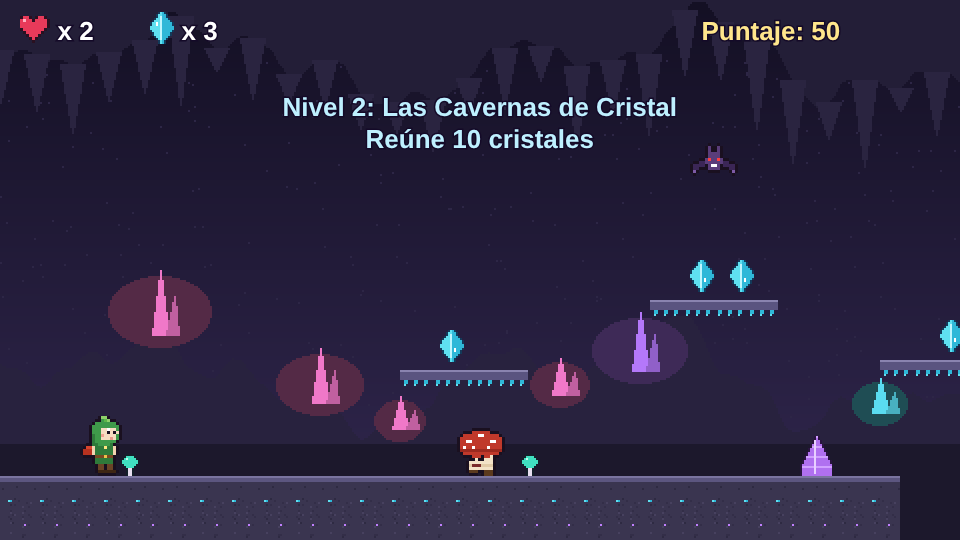

# Lumi y el Corazón de Cristal

Juego de ejemplo en **GDevelop 5** para la actividad *Desarrollando un videojuego* (EPE), Taller de Programación de Videojuegos (800TP06), IPChile.

**Docente:** Sabina Romero



## Cómo abrirlo

1. Descarga el repositorio (botón **Code → Download ZIP**) y descomprímelo completo.
2. En GDevelop 5: **Crear → Abrir un proyecto → Tu computadora** y selecciona `lumi.json`.
3. Abre la escena **Menu** y presiona **Vista previa**.

Probado en GDevelop 5.6 (build 284).

## Controles

| Tecla | Acción |
| --- | --- |
| Flechas | Moverse |
| Espacio o Shift | Saltar |
| E | Hablar con el Sabio Orión |
| ENTER | Comenzar o volver al menú |
| Espacio (en la cinemática) | Saltar la escena |

## Qué demuestra

- **Mundo de fantasía en 10 pantallas**: 5 en el Bosque de Lumen y 5 en las Cavernas de Cristal, con fondos continuos.
- **Avatar** con comportamiento Plataformero, 5 animaciones y efecto espejo.
- **3 tipos de NPC**:
  - Hongo Gruñón: patrulla entre topes invisibles.
  - Murciélago Sombrío: revolotea y persigue.
  - Sabio Orión: personaje guía con diálogo.
- **Interacción con el entorno**: cristales, pociones, runas que funcionan como *checkpoints*, portal y Corazón de Cristal.
- **Sonido**:
  - música incidental por escena;
  - ambiente en bucle;
  - pasos distintos según la superficie;
  - efectos para cada acción.
- **Estructura**: 6 escenas y 2 niveles, unidos por una **cinemática en video MP4**.
- **Hojas de eventos** organizadas en grupos comentados.

| Nivel 1 | Diálogo |
| --- | --- |
|  |  |
| **Transición** | **Nivel 2** |
|  |  |

## Estructura del repositorio

```
lumi.json          proyecto GDevelop (Menu, Nivel1, Transicion, Nivel2, Victoria, FinDelJuego)
assets/img/        62 imágenes PNG
assets/snd/        19 sonidos OGG
assets/video/      cinemática MP4 (H.264 + AAC)
herramientas/      scripts Python que generaron los recursos y una prueba automática (Playwright)
docs/capturas/     capturas del juego
```

Todos los gráficos, sonidos y el video son originales: se generaron por código con los scripts de `herramientas/`, que tienen rutas absolutas de su entorno original. Estos scripts no son necesarios para abrir ni jugar el proyecto.

## Uso académico

Este proyecto es una **referencia de alcance y calidad**, no una plantilla. Las entregas deben tener concepto, personajes y mundo propios.
